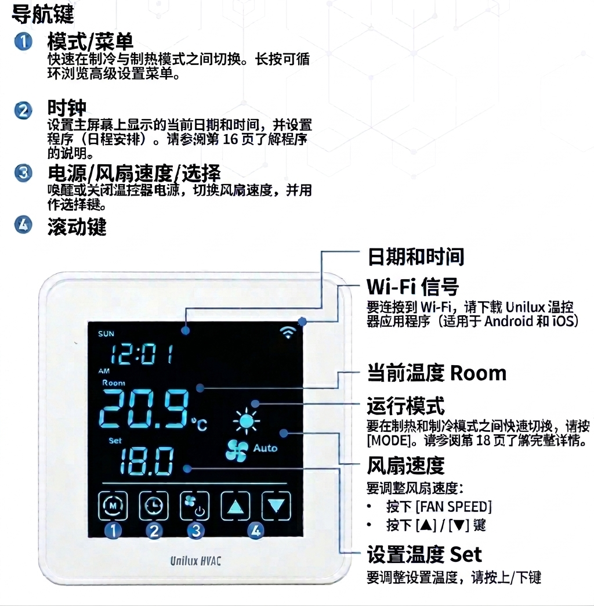

# Unilux 温控器：常见操作与设置指南 🌡️

## 1. 如何调整设定温度（目标室温） 🌡️

根据用户手册说明，您可以在主屏幕上直接通过滚动按键调整所需的设定温度：

1. 🔘 **唤醒屏幕：** 如果屏幕处于休眠状态，按一下中间的方框 **\[ \]** 按键唤醒温控器。

2. 🔼🔽 **调整温度：** 直接按下主屏幕右框区域的 **\[▲\] 向上键** 或 **\[▼\] 向下键**：
   * 按 **\[▲\]** 提高设定温度。
   * 按 **\[▼\]** 降低设定温度。

3. 画面下方的 **“Set”** 数值即为您设定的目标温度，调整后系统将自动保存并生效。

4.  画面左方的 **“Room”** 数值是 当前房间温度

---