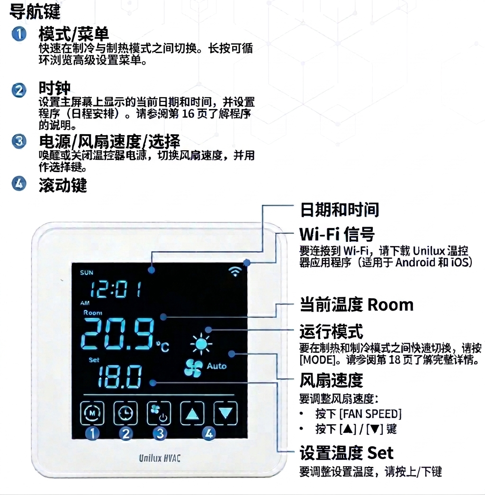

# Unilux 温控器：冷热模式切换指南 🌡️

您可以通过**快速按键**或**高级设置菜单**在制热（Heating）与制冷（Cooling）模式之间进行切换：

---

### 方法一：快速切换 ⚡（推荐）

* **操作步骤：** 直接按下温控器上的 **[MODE] (M)** 按键，即可在制热与制冷之间快速循环切换。
* **确认状态：** 屏幕上的运行模式图标将随之改变：
  * ☀️ **太阳图标**：表示正在制热模式
  * ❄️ **雪花图标**：表示正在制冷模式

---

### 方法二：高级设置菜单 ⚙️（用于选择“自动”或“关”）

如果您需要选择 **自动 (Auto)** 或 **关闭 (Off)** 模式，请通过设置菜单操作：

1. 🔘 **进入高级设置：** 按住 **[MENU] (M)** 键不放，直到进入高级设置界面。
2. 🔄 **导航至 P15：** 连续按 **[MENU] (M)** 键循环切换页面，直到屏幕顶部显示 **P15**（运行模式设置）。
3. 🔼🔽 **选择模式：** 按 **[▲] / [▼]** 上下滚动键，在以下选项中切换：
   * ☀️ **Heat**（制热）
   * ❄️ **Cool**（制冷）
   * 🔄 **Auto**（自动）
   * ⭕ **Off**（关）
4. ⚙️ **确认并退出：** 按下 **[SELECT]**（电源/风速按键 ✇/⚙️）确认选择并返回主界面。

---

*提示：在自动（Auto）模式下，温控器会根据您设置的目标温度，自动在制热和制冷之间进行智能切换。*